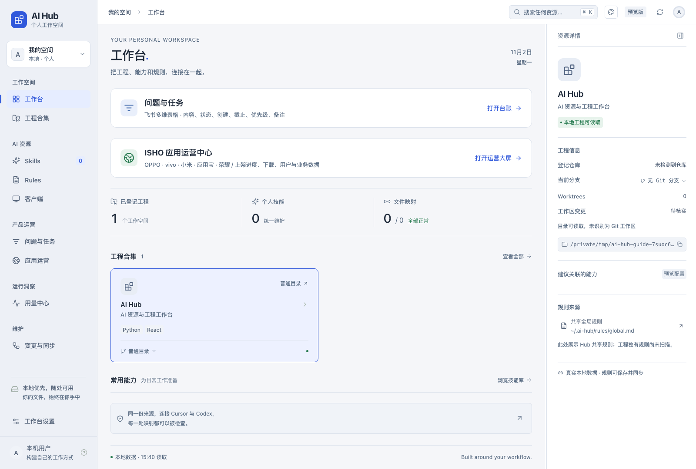
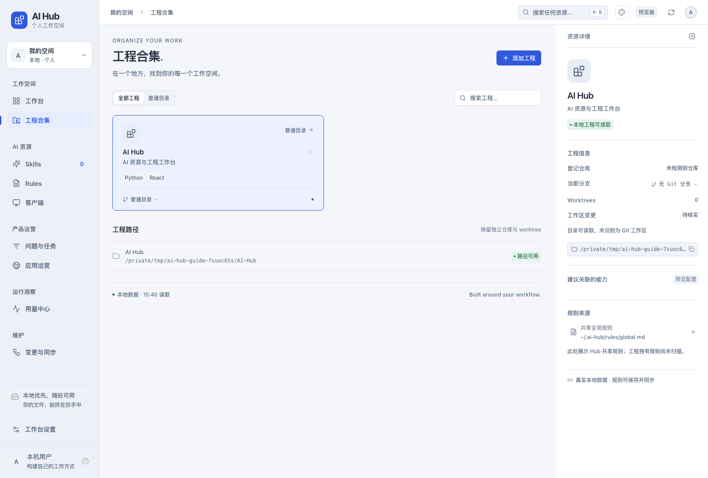
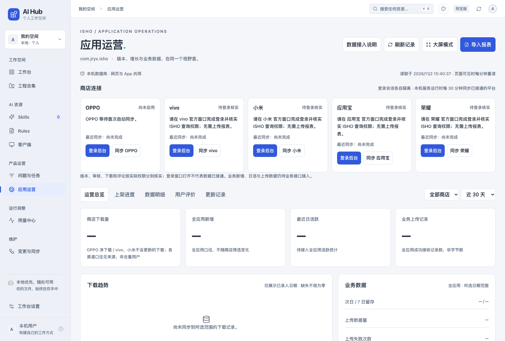

# AI Hub：把 AI 工具、工程和应用运营放在一个工作台

AI Hub 是在自己 Mac 上运行的工作台。你可以把 Cursor / Codex 的共享规则放在一处维护，集中查看工程和技能，了解本机 AI 用量，也可以查看飞书问题任务、ISHO 在各应用商店的版本、下载与评论。

网页和可选 macOS App 共用界面与本机数据。你可以只用应用运营，也可以逐步启用其他模块。公开仓库是 `ai-hub`，目前提供的是完整 AI Hub 源码。

## 先看看界面

下面是公开版在独立临时环境中实际运行的截图。没有预装个人工程、固定技能、商店登录或统计数据；截图中的待登录、待核实和空值就是首次启动状态。

### 工作台：从一个入口找到工程、规则和运营大屏



### 工程合集：把自己的项目目录登记进来



### 应用运营：五个商店的登录和同步入口



## 它能帮你做什么

| 你想做的事 | 在哪里操作 | 可以得到什么 |
| --- | --- | --- |
| 一次维护两端 AI 的约定 | Rules | 编辑共享正文、保存、检查同步，并查看冲突和待同步状态 |
| 看清有哪些个人技能 | Skills | 搜索已登记技能、阅读正文、查看 Cursor / Codex 的映射位置 |
| 管理多个代码工程 | 工程合集 | 登记本机目录，浏览分支、工作树、提交和逐行差异 |
| 看 AI 消耗和账号余量 | 用量中心 | 查看可用来源的每日 Tokens、费用估算、模型分布和额度窗口 |
| 跟进问题和任务 | 问题与任务 | 查看和筛选自己的飞书多维表，新增或修改记录并刷新读回 |
| 看 ISHO 各渠道发布情况 | 应用运营 → 上架进度 | 分开看线上版本、最新提审版本、审核流程及驳回信息 |
| 看下载和用户反馈 | 应用运营 → 运营总览 / 数据明细 / 用户评价 | 查看已采集的下载趋势、评论、评分及样本好评率 |
| 给团队单独用运营功能 | 独立运营导出 | 使用独立工作台，在本机采集或连接已部署的共享服务器 |
| 调整自己的阅读习惯 | 主题按钮 / 工作台设置 | 切换主题、字号、面板布局，保存在本机 |

## 在 Mac 上第一次运行

需要 Python 3.9+、Node.js 22.12+ 和 Git。浏览器方式即可使用工作台；构建原生 App 时才需要 Xcode 命令行工具。

1. 点击本仓库 **Code → Download ZIP**，解压后用终端进入目录。也可以克隆：

   ```bash
   git clone https://github.com/1848991298/ai-hub.git
   cd ai-hub
   ```

2. 初始化一次，安装依赖并构建网页：

   ```bash
   bash setup.command
   ```

3. 启动工作台：

   ```bash
   bash start.command
   ```

浏览器会打开 `http://127.0.0.1:4317`。看到左侧的“工作台、工程合集、Skills、Rules、问题与任务、应用运营、用量中心”，就可以开始浏览。

初始化需要联网，首次下载商店采集浏览器可能较慢。保持启动终端运行；按 `Control+C` 停止。端口已占用时用 `bash start.command --port 4318`。已有其他 Hub 时分别运行，不覆盖原目录或本机数据。

第一次只想看运营功能，可以直接点左侧 **应用运营**。第一次只想管理工程，可以直接点 **工程合集 → 添加工程**；不必先配置飞书或修改客户端全局规则。

## 按实际场景使用

### 1. 把常用工程集中起来

1. 打开 **工程合集 → 添加工程**。
2. 在系统目录选择器中选中自己的项目目录。
3. 核对识别出的目录、名称和 Git 信息，填写备注，点 **确认添加**。
4. 点击项目卡片的分支名，或在项目详情中点击 **查看 Git 详情**。选择本地分支、远端跟踪引用或工作树，即可分页查看提交、变更文件及逐行差异。

工作树的 **工作区** 视图分开显示已暂存、未暂存和未跟踪文件。逐行差异支持单栏、左右对照和折行切换。Git 详情为只读，远端跟踪显示本机上次获取的引用。

### 2. 给 Cursor 和 Codex 使用同一份规则

例如，你希望两端都遵守“中文回复、修改前检查分支、提交前确认”，可以把自己的约定写在共享正文中。

1. 先编辑 `rules/global.md` 中的通用模板，填入自己的要求。
2. 在终端执行预检，查看已有规则和入口的差异：

   ```bash
   bash scripts/pull.sh --check
   ```

3. 核对后，按自己的授权执行映射：

   ```bash
   AI_HUB_APPLY_LIVE=1 bash scripts/pull.sh --apply --to both
   ```

4. 打开 **Rules**，选择共享规则 → **编辑** → **保存并同步**，再用 **立即检查同步** 核对结果。
5. 如果显示冲突，先在 **对比** 中阅读两份正文，再选择 **使用 Hub 版本** 或 **采用客户端版本**。

固定入口是 `~/.ai-hub`。Codex 全局入口及登记技能通过链接读取 Hub；Cursor 的共享入口指向 Hub 正文，User Rules 的同步还需要运行中的 Cursor 以及 macOS 辅助功能、自动化权限。同步时可能打开 Cursor Rules。

已有入口或规则存在差异时工具会停止，请先整合。文件已映射、正文已保存、客户端会话已加载分别核实，新规则可能需要新会话才能进入上下文。

### 3. 查看和补充自己的 Skills

打开 **Skills** 可以搜索登记的技能、阅读说明与正文、查看映射到哪些客户端。公开版预装一个通用的 [按业务分批提交技能](skills/commit-by-business/SKILL.md)，不含作者个人规则和项目配置。完成映射后可使用 `$commit-by-business`：先整理文件、批次和完整提交说明，再根据授权执行；多平台项目会核对共享与独立调用链，并分别说明验证情况。

添加自己的技能时：

1. 新建 `skills/<技能名>/SKILL.md`，写入 `name`、`description` 和操作说明。
2. 按 `manifest.tsv` 的格式登记 canonical 条目。
3. 执行上述规则映射的预检和 apply，再核对客户端发现情况。

界面的 **新建技能草稿** 用于准备内容，草稿不会自动安装成技能；仍需完成文件登记和映射。产品自带、第三方和工程专属技能保留原归属。

### 4. 看 AI 用量，判断主要消耗在哪儿

1. 准备本机可用的 CodexBar / ccusage 来源及账号。
2. 需要 ccusage 时安装可选依赖：

   ```bash
   npm --prefix scripts/usage-tools ci
   ```

3. 进入 **用量中心 → 刷新用量**。
4. 切换 Codex / Cursor、近 7 天 / 近 30 天 / 全部 / 自选日期，查看 Tokens、估算费用、模型分布和账号余量。

没有来源或未取得数据时显示未知，不生成虚构用量。API 参考费用保留采集器返回的金额并标注回退定价覆盖范围；完整定价日小计单列，避免把少数日期的小计当作总额。费用不等于订阅实际账单；账号余量以采集器成功取得的窗口为准。

### 5. 把自己的飞书问题和任务接进来

该模块连接你自己的多维表，不会自动连接作者的表。先安装并以自己的账号登录 `lark-cli`，再准备两张表：问题、任务；各包含内容、状态、创建时间、截止时间、优先级、备注字段。

```bash
mkdir -p .local
cp tracker-config.example.json .local/tracker-config.json
chmod 600 .local/tracker-config.json
```

将本机配置中的示例 Base、表和字段 ID 换成自己的实际资源，重启 Hub。状态值使用“未启动／进行中／已结束”，优先级使用 P0／P1／P2。

随后进入 **问题与任务**，可以查看、筛选记录，新增问题或任务、修改状态等字段。服务运行时约每 30 秒轮询，页面刷新会重新读取；冲突时保留输入，不直接覆盖远端修改。新增和编辑还需要你的飞书账号具有对应权限。未配置时不查询任何表。

### 6. 自动汇总 ISHO 的应用商店数据

当前运营采集目标固定为 **ISHO / `com.jryx.isho`**，不是任意 App 的通用商店采集平台。

1. 打开 **应用运营**，找到要接入的商店卡片，点 **登录后台**。
2. 在该商店专用官方窗口自行完成扫码、验证码或账号验证；账号需有 ISHO 的查询权限，不需要把密码发给维护者。
3. 返回 Hub，点 **同步 OPPO / vivo / 小米**，核对版本审核、下载、评论各项的读取结果。
4. 首次同步成功后核对自动同步状态；必要时点 **启用自动**。本机服务运行期间，已启用的平台约每 30 分钟同步。
5. 登录过期时在对应官方窗口重新验证；采集失败保留旧数据并显示状态。

| 商店 | 当前源码支持范围 | 首次接入条件 |
| --- | --- | --- |
| OPPO | 线上版本、提审审核、每日净下载、评论 | 官方后台登录和 ISHO 查询权限 |
| vivo | 版本审核、下载、评论 | 自己的登录会话及字段查询权限 |
| 小米 | 版本审核、每日下载、评论 | 自己的登录会话及字段查询权限 |
| 荣耀 | 保留登录与核实入口 | 先核对已有企业／团队权限，具体数据项仍需验收 |
| 应用宝 | 保留登录入口 | 完成账号登录与权限核实，下载和评论尚未验收 |

**运营总览** 看趋势与汇总；**上架进度** 看线上和提审版本；**数据明细** 看日期指标；**用户评价** 看已采集评论；**更新记录** 查看记录变动。顶部还提供 **大屏模式** 和 **导入报表** 作为补充。

“刷新记录”只重新读已经保存的数据；查询商店请点商店卡片的“同步”。登录窗口打开不等于已成功接通；请看各项读取状态和最近成功时间。

商店下载、新增用户、日活和业务上传量是不同指标。新增、留存、活跃、上传记录数和字节数需要真实业务后端来源；源码未预接入同事的后端。缺失显示“—”，不能用 0 替代。好评率仅指已采集评论中的 4–5 星占比。采集只读，不上传 App、不提审、不发布或回复评论。

### 7. 只给运营同事使用，或连接共享服务器

完整 Hub 默认使用本机运营数据。需要单独的运营工具和可见的模式开关时，在项目根目录导出：

```bash
python3 scripts/export_market.py --directory .build/operations
cd .build/operations
bash setup.command
bash start.command
```

在独立工具的连接设置中选择：

- **独立模式**：自己登录商店、采集和保存本机数据。
- **共享服务器**：连接团队已经部署的 HTTPS 运营服务，使用管理或只读账号访问同一份服务器记录。

共享模式不会自动把你电脑的历史数据上传或合并，连接失败也不回退本机。`deploy/market/` 提供服务器部署配置；下载本仓库并不代表已经有云服务器，云端采集仍需另行部署和验证。更多步骤见 [运营与部署说明](docs/market-operations.md)。

### 8. 作为 macOS App 打开

网页已能使用全部工作台页面。想用原生窗口时，准备 Xcode 命令行工具，在项目根目录执行：

```bash
python3 scripts/build_macos_app.py
```

生成 `dist/AI Hub.app`，首次打开时选择自己的 Hub 源码目录。该 App 是本机架构的外壳，仍需 Python、源码目录和对应依赖；不属于免运行环境的安装包。

## 常见问题

| 看到的情况 | 怎么处理 |
| --- | --- |
| Skills 为 0，工程只有 AI Hub | 公开版没有附带作者个人内容，按上文登记自己的资源 |
| 运营页面没有版本或图表 | 先登录商店并同步；缺少权限或业务接口的数据会保持未知 |
| 点击刷新记录却没查到新商店数据 | 使用该商店卡片上的“同步”，查看逐项结果 |
| Rules 显示待同步或权限不足 | 检查共享入口、Cursor 是否运行，以及系统辅助功能／自动化授权 |
| 关闭终端后不再自动同步 | 自动同步随本机服务运行；重新启动，或另行部署长期运行的服务 |
| 想让同事看到同一批数据 | 使用已部署的共享运营服务；只下载代码不会自动共享你的本机数据库 |

## 数据放在哪里，更新时如何保留

`.local/` 保存自己的工程登记、偏好、台账配置、数据库、采集状态及登录资料。更新源码时保留这个目录；不要把别人的 `.local/` 拷入自己的工作台。备份和迁移说明见 [迁移说明](docs/portability.md)。

源码仓库排除 `.local/`、`.backups/`、`archive/`、`dist/`、`.build/`、依赖、凭据和客户端副本。修改过自己的规则、技能或资源地址后，再公开 fork 前重新检查。`python3 scripts/export_public_hub.py` 可导出通用模板源码和已审查的文档截图；自动扫描不能替代人工检查图片中的个人信息。

## 开发者验证

```bash
python3 -m unittest discover -s scripts -p 'test_*.py'
node --test ui/src/*.test.js
node --test scripts/market-browser/test-*.mjs
npm --prefix ui run build
```

测试使用临时数据与夹具；真实账号、客户端权限及服务器在使用者环境另行验收。没有附开源许可证时，不代表授予任意再分发或商业使用权。

### 自由布局、模型筛选和日明细

- Rules 占满正文可用宽度，规则列表与正文间可拖动分栏，宽度按本机记忆。
- 问题与任务的行保持对齐，支持拖动列序、列边缘缩放和输入像素。内容列可缩至 64 px，其他列可缩至 44–48 px；手动宽度独立保存，仅点击「适应当前窗口」时重新分配。未配置标签字段时保留六字段兼容行为。
- 用量页的「模型」菜单支持多选、全选、清空和搜索，筛选同时作用于数值与趋势。移入柱状图预览，点击固定日明细，方向键移动焦点、回车选择；长区间可查看组内逐日明细。未取得的分项费用保持未知，不按 tokens 比例分摊。
- 「参考费用」包含采集器回退估算，「完整定价」排除含回退价格的日期，二者都不代表订阅应付账单。
- 「重新检测权限」只读核对实际同步进程的辅助功能与自动化访问；成功后清除旧权限错误，不标记正文已同步。重新构建或更换应用可能改变 macOS 识别的授权身份，已有开关不等于当前进程必然通过。
- 模型与列布局菜单加入短促展开反馈，并尊重系统减少动态效果设置。交互参考 [TanStack Table](https://github.com/TanStack/table) 与 [shadcn/ui](https://github.com/shadcn-ui/ui)，复用现有 React、CSS 和 Lucide，无新增依赖。
